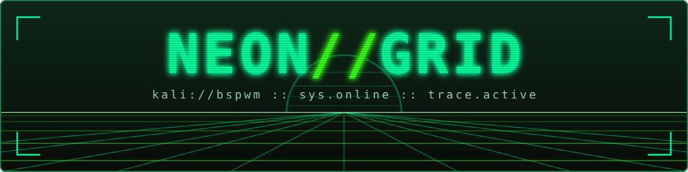
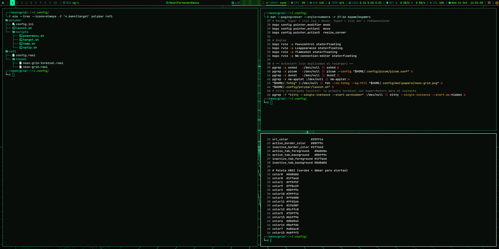
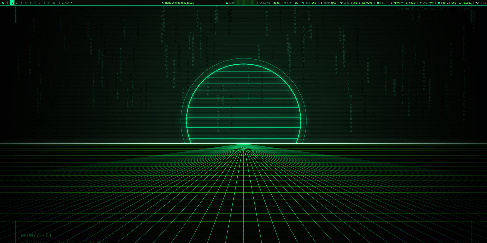
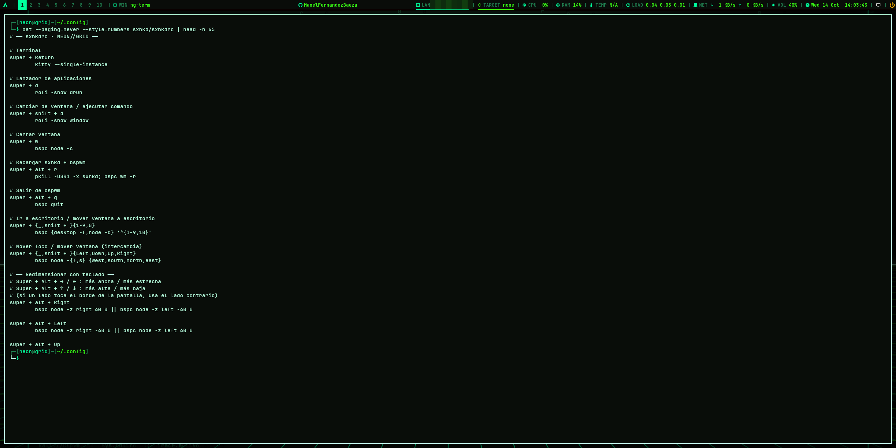
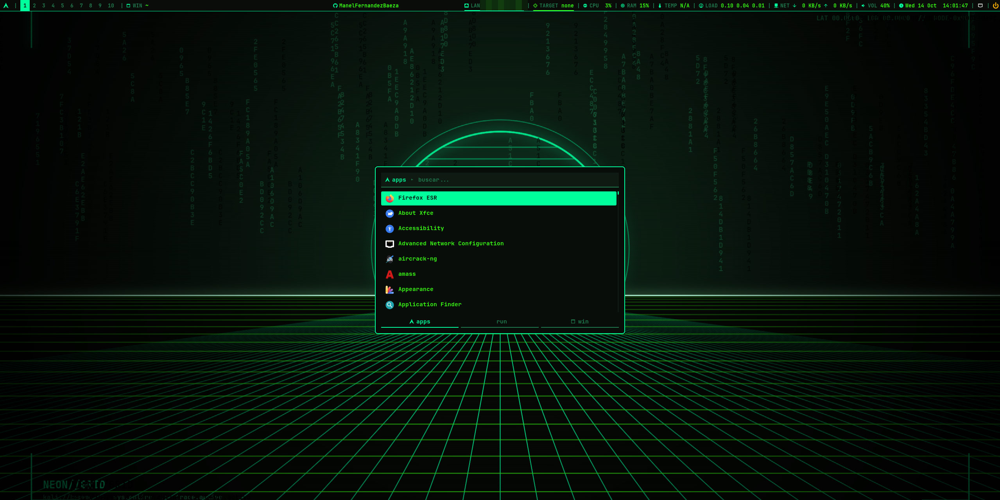
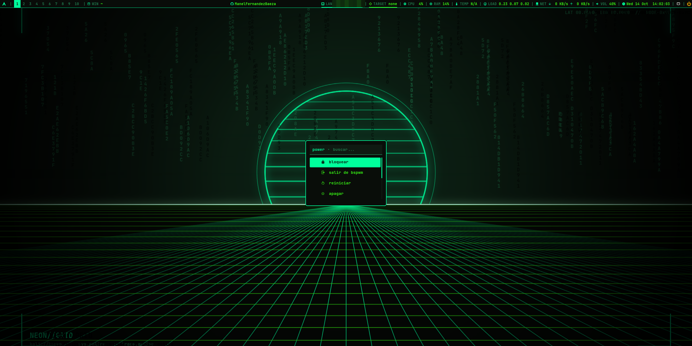
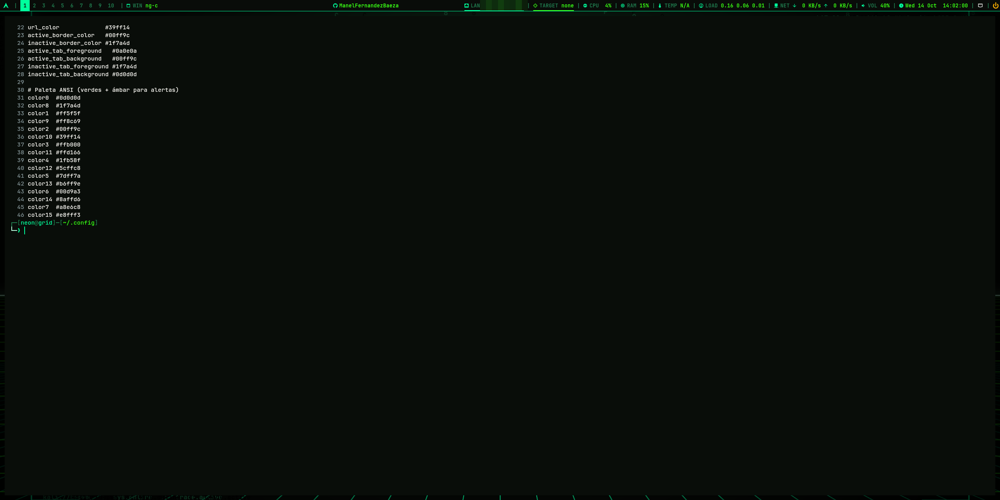

<div align="center">



**Un escritorio bspwm cyberpunk verde para Kali Linux, instalado con un solo script.**

🇬🇧 [English](README.md) | 🇪🇸 **Español**

<br>


<br>


</div>

---

## Índice

1. [¿Qué es NEON//GRID?](#-qué-es-neongrid)
2. [Capturas](#-capturas)
3. [Características](#-características)
4. [Requisitos](#-requisitos)
5. [Instalación rápida](#-instalación-rápida)
6. [Qué hace exactamente el script](#-qué-hace-exactamente-el-script)
7. [Primer inicio](#-primer-inicio)
8. [Atajos de teclado principales](#-atajos-de-teclado-principales)
9. [Desinstalación / volver al escritorio anterior](#-desinstalación--volver-al-escritorio-anterior)
10. [Solución de problemas](#-solución-de-problemas)
11. [Estructura del repositorio](#-estructura-del-repositorio)
12. [Autor y licencia](#-autor-y-licencia)

---

## 🟢 ¿Qué es NEON//GRID?

**NEON//GRID** convierte una instalación de Kali Linux en un escritorio tiling basado en **bspwm**, con un tema cyberpunk verde propio: un wallpaper de rejilla generado por código, una **polybar** con brillo neón, temas de **rofi** a medida, una terminal **kitty** ajustada, un prompt **powerlevel10k** verde y varias funciones de shell pensadas para pentesting.

Todo lo hace un único script de Bash idempotente, [`install-neon-grid.sh`](install-neon-grid.sh). Guarda una copia de tus configuraciones antes de sobrescribirlas y se puede volver a lanzar sin problemas.

Paleta: fondo `#0a0e0a` · neón `#00ff9c` · acento `#39ff14` · secundario `#1f7a4d` · alerta `#ffb000`. Fuente: **JetBrainsMono Nerd Font**.

> [!NOTE]
> La guía de uso original, [`docs/guia-entorno.pdf`](docs/guia-entorno.pdf), está en español. La referencia completa de atajos está en [`docs/es/ATAJOS.md`](docs/es/ATAJOS.md).

## 📸 Capturas

<div align="center">



<sub><b>Mosaico</b>: tres terminales kitty organizadas por bspwm</sub>

</div>

<br>

| Escritorio limpio | Terminal |
|:---:|:---:|
|  |  |
| **Lanzador de aplicaciones (rofi)** | **Menú power** |
|  |  |
| **Modo monóculo** | |
|  | |

## ✨ Características

- **bspwm + sxhkd** en mosaico con 10 escritorios, huecos de 12 px, bordes verdes y mover/redimensionar con el ratón usando <kbd>Super</kbd>.
- **Compositor según la GPU**: en cada inicio de sesión `bspwmrc` comprueba OpenGL con `glxinfo` y elige la config completa de **picom** (glx, blur, sombras) o una ligera (xrender, sin blur) para máquinas virtuales sin 3D.
- **polybar** con módulos de icono + etiqueta: escritorios, ventana activa, IP LAN/VPN, `TARGET`, CPU, RAM, temperatura, carga, velocidad de red, volumen, reloj, bandeja y botón de apagado.
- **rofi** como lanzador con dos temas propios (`neon-grid` y `neon-grid-terminal`) y un menú power hecho con rofi.
- Terminal **kitty** precargada y oculta al arrancar, así que <kbd>Super</kbd>+<kbd>Return</kbd> abre al instante.
- **zsh + powerlevel10k** (prompt verde estilo "lean"), zsh-autosuggestions y zsh-syntax-highlighting; prompt a juego para bash.
- **tmux** con tema verde y prefijo `Ctrl+a`.
- Notificaciones con **dunst**, capturas con **flameshot** y teclas de volumen.
- **Funciones de pentesting**: `settarget`, `cleartarget`, `gettarget`, `mkt` y `extractPorts`, con el objetivo actual visible en polybar y tmux.
- **Wallpaper original y procedural** generado con Python + ImageMagick.
- **Relanzable sin miedo**: las configs que cambian se guardan en `~/.neon-grid-backup-<fecha>/`.

## 📋 Requisitos

| Requisito | Detalles |
|---|---|
| Sistema | **Kali Linux** (rolling). En otros sistemas Debian/apt muestra un aviso, pero lo intenta igualmente. |
| Usuario | Un **usuario normal con sudo**. El script se niega a ejecutarse como root. |
| Internet | Necesario: `apt`, la descarga de JetBrainsMono Nerd Font y el `git clone` de powerlevel10k. |
| Gestor de inicio | **LightDM** para dejar bspwm como sesión por defecto automáticamente (es el de Kali). También funciona `startx` desde una TTY. |
| Arquitectura | **amd64** de 64 bits (x86_64) |
| CPU | **4 núcleos** (2 procesadores × 2 núcleos), como en la guía de VM de Kali · Kali no fija un mínimo oficial |
| RAM | **2 GB** mínimo · mejor más si tu equipo anfitrión puede permitírselo |
| Disco | **20 GB** mínimo · la guía de VM de Kali usa **80 GB** |
| Versiones | `picom.conf` usa la sintaxis `rules` (picom **v12+**) y polybar usa `internal/tray` (polybar **3.7+**). La kali-rolling actual trae versiones compatibles. |

Los valores de hardware son los [requisitos oficiales de instalación](https://www.kali.org/docs/installation/hard-disk-install/) de Kali para una instalación con escritorio y los de su [guía para VMware](https://www.kali.org/docs/virtualization/install-vmware-guest-vm/).

> [!TIP]
> En una máquina virtual, activa la **aceleración 3D** para tener blur y sombras completas. Sin ella NEON//GRID funciona igual con la config ligera de picom.

## 🚀 Instalación rápida

```bash
git clone https://github.com/ManelFernandezBaeza/neon-grid.git
cd neon-grid
chmod +x install-neon-grid.sh
./install-neon-grid.sh
```

Opciones:

| Opción | Efecto |
|---|---|
| `--no-pdf` | No genera la guía PDF (`~/guia-entorno.pdf`) |
| `--no-session` | No pone bspwm como sesión por defecto en LightDM |
| `--skip-packages` | No instala paquetes con `apt` |
| `-h`, `--help` | Muestra la cabecera de ayuda |

> [!WARNING]
> Ejecútalo como tu **usuario normal**, no con `sudo ./install-neon-grid.sh`. Pide la contraseña de sudo cuando la necesita y la mantiene activa durante la instalación. Además, **cambia tu shell de inicio a zsh**.

Guía completa: [`docs/es/INSTALACION.md`](docs/es/INSTALACION.md).

## 🔧 Qué hace exactamente el script

| # | Paso | Detalles |
|:-:|---|---|
| 0 | **Comprobaciones** | No es root, detecta Kali (si no, avisa), hay `apt-get` y `sudo`. Mantiene sudo activo en segundo plano. |
| 1 | **Paquetes** | Instala con `apt` solo los que faltan (ver lista abajo). Enlaza `batcat` → `/usr/local/bin/bat` si hace falta. |
| 2 | **Fuente** | Descarga la última **JetBrainsMono Nerd Font** en `~/.local/share/fonts/JetBrainsMonoNF` y refresca la caché de fuentes. |
| 3 | **powerlevel10k** | `git clone --depth=1` en `~/.powerlevel10k`. |
| 4 | **Configuraciones** | Escribe bspwm, sxhkd, polybar (+ scripts), picom, rofi (+ temas), kitty, dunst, el generador del wallpaper, las funciones, las fuentes de la guía, p10k, tmux, `.xinitrc` y `.fehbg`. Antes de cambiar un archivo lo copia en `~/.neon-grid-backup-<fecha>/`. Enlaza `~/.local/share/rofi/themes` → `~/.config/rofi/themes`. |
| 5 | **Shells** | Integra las funciones y powerlevel10k en `~/.zshrc`, y las funciones + un prompt verde en `~/.bashrc` (backups: `*.bak-pre-neongrid`). Pone **zsh** como shell de inicio con `chsh`. |
| 6 | **Wallpaper** | Genera `~/.config/wallpapers/neon-grid.png` (2560×1440) si no existe. |
| 7 | **Sesión** | Escribe `~/.dmrc` y `/var/lib/AccountsService/users/$USER` para que LightDM arranque **bspwm** por defecto (se omite con `--no-session`). |
| 8 | **Guía PDF** | Genera `~/guia-entorno.pdf` con pandoc + weasyprint (se omite con `--no-pdf`). |
| 9 | **Recarga** | Si ya estás dentro de bspwm, reinicia sxhkd/picom y recarga bspwm. |

<details>
<summary><b>Paquetes que instala con apt</b></summary>

| Categoría | Paquetes |
|---|---|
| Escritorio | `bspwm` `sxhkd` `polybar` `picom` `rofi` `feh` `kitty` `dunst` `lxappearance` `network-manager-gnome` `pavucontrol` |
| Base X / utilidades | `xorg` `xinit` `xclip` `xdotool` `jq` `curl` `git` `unzip` `imagemagick` `mesa-utils` |
| Fuentes | `fonts-jetbrains-mono` `fontconfig` |
| Terminal / QoL | `zsh` `zsh-autosuggestions` `zsh-syntax-highlighting` `tmux` `btop` `ripgrep` `fzf` `bat` `eza` `neovim` |
| Pentesting / red | `nmap` `net-tools` `seclists` `flameshot` |
| Documentación | `pandoc` `weasyprint` |

</details>

<details>
<summary><b>Archivos que crea o modifica</b></summary>

| Ruta | Función |
|---|---|
| `~/.config/bspwm/bspwmrc` | bspwm: huecos, bordes, ratón, reglas, autostart |
| `~/.config/sxhkd/sxhkdrc` | Atajos de teclado |
| `~/.config/polybar/config.ini`, `launch.sh`, `scripts/*.sh`, `target` | Barra, lanzador, módulos, IP objetivo actual |
| `~/.config/picom/picom.conf`, `picom-lite.conf` | Compositor con / sin GPU |
| `~/.config/rofi/config.rasi`, `themes/neon-grid*.rasi` | Config y temas de rofi |
| `~/.config/kitty/kitty.conf` | Terminal y paleta ANSI verde |
| `~/.config/dunst/dunstrc` | Notificaciones |
| `~/.config/wallpapers/neon-grid.png`, `src/neon-grid.py` | Wallpaper y su generador |
| `~/.config/neon-grid/functions.sh` | Funciones y alias de pentesting |
| `~/.config/neon-grid/doc/` | Fuentes de la guía (Markdown + CSS) |
| `~/.p10k.zsh`, `~/.powerlevel10k/` | Config y tema de powerlevel10k |
| `~/.tmux.conf`, `~/.xinitrc`, `~/.fehbg` | tmux, `startx`, último wallpaper |
| `~/.zshrc`, `~/.bashrc` | Modificados (backups `*.bak-pre-neongrid`) |
| `~/.dmrc`, `/var/lib/AccountsService/users/$USER` | Sesión por defecto = bspwm |
| `~/.local/share/fonts/JetBrainsMonoNF/` | Nerd Font |
| `~/.local/share/rofi/themes` | Enlace a `~/.config/rofi/themes` |
| `/usr/local/bin/bat` | Enlace a `batcat` (si hace falta) |
| `~/guia-entorno.pdf` | Guía generada (en español) |

</details>

## 💻 Primer inicio

1. **Cierra sesión** cuando termine el script.
2. En la pantalla de **LightDM**, abre el selector de sesión (icono arriba a la derecha). **bspwm** ya aparece como tu sesión por defecto; XFCE sigue disponible en el mismo menú.
3. Inicia sesión. `bspwmrc` detecta la GPU y arranca sxhkd, picom, dunst, nm-applet, el wallpaper, polybar y un kitty oculto precargado.

Sin gestor gráfico: cambia a una TTY (<kbd>Ctrl</kbd>+<kbd>Alt</kbd>+<kbd>F3</kbd>), inicia sesión y ejecuta `startx` (usa `~/.xinitrc`, que hace `exec bspwm`).

> [!NOTE]
> Todos los atajos usan la tecla <kbd>Super</kbd> (la tecla Windows) como modificador.

## ⚡ Atajos de teclado principales

| Atajo | Acción |
|---|---|
| <kbd>Super</kbd> + <kbd>Return</kbd> | Abrir terminal (kitty) |
| <kbd>Super</kbd> + <kbd>d</kbd> | Lanzador de aplicaciones (rofi drun) |
| <kbd>Super</kbd> + <kbd>Shift</kbd> + <kbd>d</kbd> | Lista de ventanas abiertas (rofi window) |
| <kbd>Super</kbd> + <kbd>w</kbd> | Cerrar la ventana enfocada |
| <kbd>Super</kbd> + <kbd>1…9, 0</kbd> | Ir al escritorio 1…10 |
| <kbd>Super</kbd> + <kbd>Shift</kbd> + <kbd>1…9, 0</kbd> | Mover la ventana al escritorio 1…10 |
| <kbd>Super</kbd> + <kbd>←↓↑→</kbd> | Mover el foco |
| <kbd>Super</kbd> + <kbd>Shift</kbd> + <kbd>←↓↑→</kbd> | Intercambiar la ventana en esa dirección |
| <kbd>Super</kbd> + <kbd>Alt</kbd> + <kbd>←↓↑→</kbd> | Redimensionar la ventana (40 px por pulsación) |
| <kbd>Super</kbd> + <kbd>f</kbd> | Pantalla completa real (tapa la barra) |
| <kbd>Super</kbd> + <kbd>m</kbd> | Alternar modo monóculo |
| <kbd>Super</kbd> + <kbd>s</kbd> / <kbd>t</kbd> | Flotante / mosaico |
| <kbd>Super</kbd> + <kbd>Alt</kbd> + <kbd>r</kbd> | Recargar bspwm + sxhkd |
| <kbd>Super</kbd> + <kbd>Alt</kbd> + <kbd>p</kbd> | Menú power |
| <kbd>Super</kbd> + <kbd>Alt</kbd> + <kbd>q</kbd> | Salir de bspwm |
| <kbd>Print</kbd> | Captura de pantalla (`flameshot gui`) |

📖 Referencia completa (ratón, rofi, recargar componentes, tmux, comandos propios): [`docs/es/ATAJOS.md`](docs/es/ATAJOS.md).

## 🔙 Desinstalación / volver al escritorio anterior

El script **no incluye un desinstalador automático**, pero guarda todo lo necesario para volver atrás:

1. **Cambia de sesión**: en la pantalla de LightDM elige **XFCE** (o tu escritorio anterior) en el selector de sesión.
2. **Restaura las configs**: copia tus archivos desde `~/.neon-grid-backup-<fecha>/` (solo se crea para los archivos que se sobrescribieron).
3. **Restaura las shells**: `mv ~/.zshrc.bak-pre-neongrid ~/.zshrc` y `mv ~/.bashrc.bak-pre-neongrid ~/.bashrc`.
4. **Shell de inicio**: `chsh -s /bin/bash` si prefieres volver a bash.
5. **Limpieza opcional**: borra `~/.config/{bspwm,sxhkd,polybar,picom,rofi,kitty,dunst,wallpapers,neon-grid}`, `~/.powerlevel10k`, `~/.p10k.zsh`, `~/.local/share/fonts/JetBrainsMonoNF` y ejecuta `fc-cache -f`.

Paso a paso: [`docs/es/INSTALACION.md`](docs/es/INSTALACION.md#desinstalación--volver-al-escritorio-anterior).

## 🧯 Solución de problemas

| Problema | Solución rápida |
|---|---|
| Sin blur / la VM va lenta | Activa la aceleración 3D en la VM; compruébalo con `glxinfo -B \| grep -E "renderer\|core profile"` |
| `TEMP` muestra `N/A` | Es normal en VMs sin sensores de temperatura |
| Iconos cuadrados en la barra | Falta la Nerd Font: `fc-list : family \| grep -i "JetBrainsMono Nerd"` |
| bspwm no aparece en LightDM | Comprueba que el paquete `bspwm` está instalado y su archivo de sesión existe en `/usr/share/xsessions/` |
| No se ve la polybar | Ejecuta `~/.config/polybar/launch.sh` y revisa `/tmp/polybar-*.log` |
| No se genera la guía PDF | Faltan `pandoc`/`weasyprint`; instálalos o usa `--no-pdf` |

Más problemas y soluciones: [`docs/es/SOLUCION-PROBLEMAS.md`](docs/es/SOLUCION-PROBLEMAS.md).

## 📁 Estructura del repositorio

```text
neon-grid/
├── install-neon-grid.sh          # el instalador
├── README.md                     # inglés
├── README.es.md                  # español (este archivo)
├── LICENSE                       # GNU GPL v3
├── CHANGELOG.md
├── docs/
│   ├── guia-entorno.pdf          # guía original (español)
│   ├── en/                       # INSTALLATION · SHORTCUTS · TROUBLESHOOTING
│   └── es/                       # INSTALACION · ATAJOS · SOLUCION-PROBLEMAS
├── assets/
│   ├── banner.svg
│   └── screenshots/
└── .github/workflows/shellcheck.yml
```

## 👤 Autor y licencia

Creado por **[ManelFernandezBaeza](https://github.com/ManelFernandezBaeza)**.

Publicado bajo la **Licencia Pública General de GNU v3.0 o posterior** (`GPL-3.0-or-later`). Consulta [`LICENSE`](LICENSE).

<div align="center">

<sub><code>kali://bspwm :: sys.online :: trace.active</code></sub>

</div>
